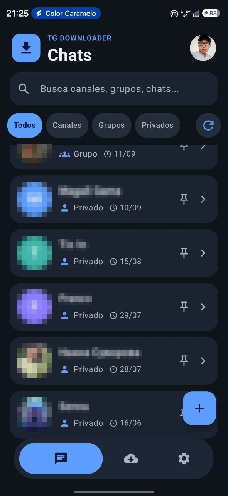
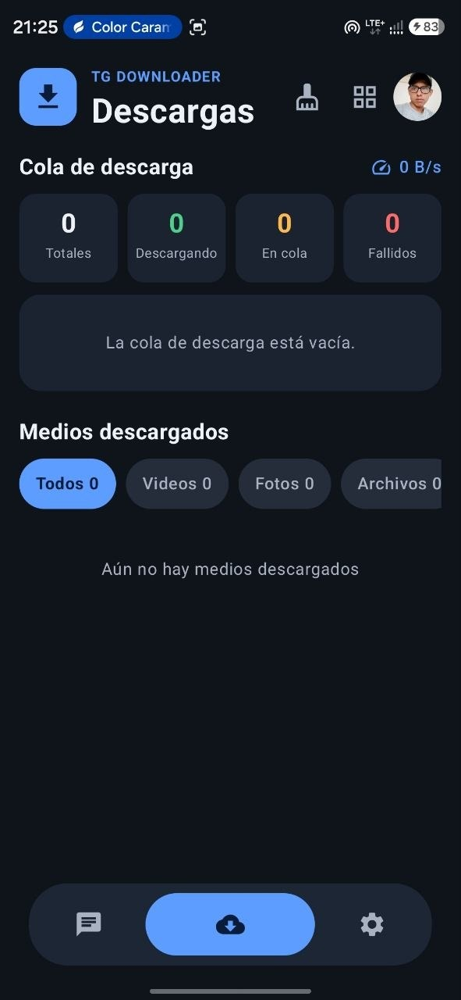
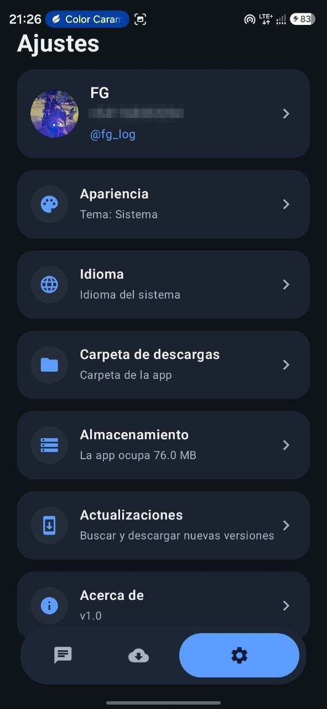

# 📥 FG TDownloader

**Explora tus chats de Telegram y descarga fotos, videos, audios y archivos, rápido y sin complicaciones.**

[⬇️ **Descargar APK**](https://github.com/fg-error/FG-TDL/releases) · [☕ Apoyar el proyecto](https://cafecito.app/fg_error)

---

## 📱 Capturas

<table>
  <tr>
    <td align="center"> <b>Tus chats</b></td>
    <td align="center"> <b>Cola de descargas</b></td>
    <td align="center"> <b>Ajustes</b></td>
  </tr>
</table>

---

## ✨ ¿Qué hace?

FG TDownloader es un cliente de Telegram nativo para Android, hecho con **Kotlin**, **Jetpack Compose** y **TDLib** (la librería oficial de Telegram). Inicias sesión con tu propia cuenta y puedes ver y descargar el contenido de los chats, canales y grupos a los que **tu cuenta ya tiene acceso**.

### 🔐 Inicio de sesión
- Acceso con número de teléfono (con selector de país), código de verificación y contraseña de dos pasos.
- La sesión se mantiene al cerrar la app.
- **Varias cuentas**: añade otra cuenta y cambia entre ellas desde tu perfil.

### 💬 Chats
- Lista de tus chats con avatares y filtros: **Todos, Canales, Grupos y Privados**.
- Búsqueda rápida y chats fijados.
- Añade un canal o grupo pegando su enlace o `@usuario` (`t.me/...`, `t.me/+HASH`, `tg://...`), **sin unirte a él**.

### 🖼️ Galería de cada chat
- Cuadrícula de miniaturas con filtros **Todos / Videos / Fotos / Audio / Archivos** y contadores.
- Búsqueda por nombre o texto, orden por más recientes o más antiguos, miniaturas grandes o pequeñas.
- **Sincronizar lo último** para traer lo más reciente.
- Selección múltiple, *seleccionar todo* y descarga individual o en lote.
- Vista previa dentro de la app: zoom en fotos y reproductor de video.

### ⬇️ Descargas
- Cola con **hasta 3 descargas en paralelo**, con progreso, velocidad, tiempo restante, reintentar y cancelar.
- Lo descargado se recuerda entre sesiones.
- Ver, compartir (uno o varios), abrir la carpeta y eliminar.
- Guarda donde tú quieras: almacenamiento de la app, galería del dispositivo o **una carpeta que elijas**.

### ⚙️ Ajustes
- 🎨 Tema: sistema, claro u oscuro.
- 🌐 Idioma: **español, inglés** o el del sistema.
- 📁 Carpeta de descargas personalizada.
- 💾 Almacenamiento: cuánto ocupa la app y limpieza de caché con un toque.
- 🔄 Actualizaciones: busca y descarga nuevas versiones desde GitHub, con aviso por notificación.

---

## 📲 Instalación

1. Ve a la sección de [**Releases**](https://github.com/fg-error/FG-TDL/releases) y descarga el último `.apk`.
2. Ábrelo en tu teléfono y permite instalar apps desde esa fuente si Android te lo pide.
3. Inicia sesión con tu número de Telegram y listo.

**Requisitos:** Android 7.0 (API 24) o superior.

---

## 🔒 Privacidad

- La app funciona con **tu propia cuenta** de Telegram y solo accede a lo que tu cuenta ya puede ver.
- No incluye anuncios ni analítica.
- Tus archivos se guardan en tu dispositivo.

> FG TDownloader no está afiliado ni respaldado por Telegram. Úsalo de forma responsable y respeta los derechos de autor y las normas de Telegram.

---

## 💙 Apoya el proyecto

Si la app te sirvió, puedes apoyar su desarrollo:

## 🌐 Redes

---

Hecho por **FG** · [@fg-error](https://github.com/fg-error)

